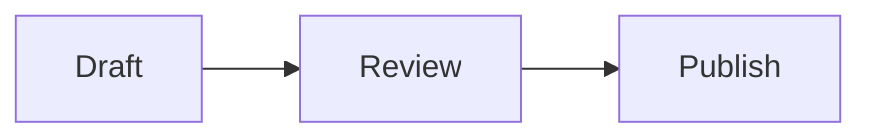

# The s-md-slides format, version 1

An s-md-slides deck is one markdown file. Each box on a slide is a one-line HTML comment that says where the box sits, followed by normal markdown for what goes in it. Markdown viewers hide the comments, so the file still reads as a document on GitHub, in Obsidian or in a terminal.

Every example in this file is a test: `cargo test -p s-md-slides --test docs` parses each `markdown` block and fails if any of them reports a problem.

## A whole deck

```markdown
---
s-md-slides: 1
title: Q3 review
canvas: 16:9
---

<!-- text id=t1 x=120 y=80 w=1680 h=200 size=72 weight=bold -->
# Revenue grew 18%

<!-- image id=i1 x=120 y=320 w=900 h=600 fit=contain -->


<!-- notes -->
Mention the new pricing first.

---

# A second slide

Plain markdown with no comments becomes one text box that fills the slide.
```

## Grammar

1. The file is UTF-8. A byte order mark at the start is kept. Line endings (LF or CRLF) are kept, and new lines use the file's most common ending.
2. Front matter is optional YAML between two `---` lines at the very top.
3. A line that is exactly `---` (trailing spaces allowed), outside front matter and outside code fences, separates sections. Inside slide text, write a horizontal rule as `***` or `___`.
4. A section whose first directive is `master` or `layout` holds definitions. Every other section is a slide, optionally opened by `<!-- slide ... -->`.
5. A directive is a whole line `<!-- kind key=value ... -->`. It counts only when `kind` is one the format knows (slide, master, layout, placeholder, notes, text, image, shape, code, table, diagram, math, video, embed, group) or when it has an `id=`. Any other comment, like `<!-- fix this later -->`, stays ordinary text.
6. Attributes are `key=value`, `key="quoted value"` (with `\"` and `\\` escapes) or a bare `key` meaning true. Their order is kept. If a key appears twice, the last one wins and you get a warning.
7. A body runs from the line after its directive to the next directive, the next `---` or the end of the file. Blank lines at the end of a body are spacing between elements, not part of the body.
8. Markdown before a slide's first element becomes a text box filling the slide's safe area (5% margins), with an id the engine assigns.
9. `<!-- notes -->` starts the slide's speaker notes, which run to the end of the slide.
10. Ids are 1 to 32 characters of `a-z`, `0-9` and `-`, unique in the deck. The engine generates them as a kind letter plus a counter (`t1`, `i4`, `s12`) and writes an element's id the first time that element is edited.
11. Numbers are written as integers when whole, otherwise with up to two decimals. Positions and sizes are canvas units, `rot` is degrees, `delay` and `dur` are milliseconds.
12. Colors are `#rgb`, `#rrggbb`, `#rrggbbaa` or a theme role (`background`, `text`, `accent1` to `accent6`, `code`, `code-bg`). Fills and backgrounds also take `linear(angle,color,color)` with two or three colors.

Anything the engine doesn't know (front matter keys, attributes, directive kinds with an id) is kept exactly where it is when the file is saved.

## Front matter

| Key | Values | Default |
| --- | --- | --- |
| `s-md-slides` | format version | `1`. A newer version opens read-only. |
| `title`, `author` | text | none |
| `canvas` | `16:9` (1920 x 1080), `4:5` (1080 x 1350) or `WxH` such as `1200x800` | `16:9` |
| `dir` | `auto`, `ltr`, `rtl` | `auto` (the first strong letter decides) |
| `lang` | a language tag such as `en` or `ar` | `en` |
| `theme` | an inline mapping, or a path to a JSON theme | the built-in theme |
| `transition` | `none`, `fade`, `push` | `fade` |

## Attributes every element takes

`id`, `x`, `y`, `w`, `h` (required for the built-in kinds), `rot`, `opacity` (0 to 1), `locked`, `name`, `dir`.

Style: `font`, `size`, `color`, `weight` (`normal`, `bold` or 100 to 900), `align` (`left`, `center`, `right`, `justify`, `start`, `end`), `valign` (`top`, `middle`, `bottom`), `line-height`, `padding` (one to four numbers, such as `24` or `24,48`), `fill`, `stroke`, `stroke-width`, `radius`.

Animation: `enter` and `exit` (`appear`, `fade`, `fly-left`, `fly-right`, `fly-up`, `fly-down`, `scale`), `order` (the click that plays it, from 1; without it the effect plays when the slide appears), `delay` and `dur` in milliseconds (`dur` defaults to 400).

## Elements

### Text

Markdown: headings, emphasis, lists, links, inline code, tables, `$math$`.

```markdown
<!-- text id=t1 x=120 y=80 w=1680 h=300 size=48 align=center color=#ffffff valign=middle -->
# A heading

Some **bold** text, a [link](https://example.com) and `code`.
```

### Image

One markdown image. `fit` is `contain` (default), `cover` or `fill`. `crop=x,y,w,h` crops in image pixels. Images without alt text get a warning.

```markdown
<!-- image id=i1 x=0 y=0 w=960 h=540 fit=cover crop=0,0,800,450 -->

```

### Shape

`kind` is `rect` (default), `ellipse`, `line` or `arrow`. Lines and arrows run from `(x, y)` to `(x + w, y + h)` and may leave out `h` (a horizontal line). Arrows have a head at the end; `arrow-start=triangle` adds one at the start and `arrow-end=none` removes the end one. Rectangles and ellipses can hold text.

```markdown
<!-- shape id=s1 kind=rect x=100 y=100 w=400 h=200 fill=accent1 radius=16 -->
Text inside the box

<!-- shape id=s2 kind=arrow x=100 y=400 w=600 stroke=accent2 stroke-width=4 -->
```

### Code

One fenced code block with a language tag. `lines=1,3-5` highlights lines.

````markdown
<!-- code id=c1 x=100 y=100 w=900 h=400 lines=2 -->
```rust
let deck = Deck::parse(&text).deck;
let undo = deck.apply(op)?;
```
````

### Table

One markdown table. `header=false` styles the first row like the others.

```markdown
<!-- table id=b1 x=100 y=100 w=800 h=300 -->
| Region | Q2 | Q3 |
|:-------|---:|---:|
| Kuwait | 10 | 12 |
```

### Diagram

One Mermaid block. Native export draws it; the HTML export shows its source, and hosts like Obsidian draw it themselves.

````markdown
<!-- diagram id=d1 x=100 y=100 w=800 h=500 -->

````

### Math

One `$$...$$` block or one fenced `math` block, in LaTeX.

```markdown
<!-- math id=m1 x=100 y=100 w=800 h=200 -->
$$E = mc^2$$
```

### Video

`src` is required. `poster` is the still shown in PDF and images. `autoplay`, `loop` and `muted` are flags.

```markdown
<!-- video id=v1 x=100 y=100 w=960 h=540 src=assets/demo.mp4 poster=assets/demo.jpg muted loop -->
```

### Embed

An https page in an iframe, such as YouTube (rewritten to youtube-nocookie) or Vimeo. Exports other than HTML show `poster`.

```markdown
<!-- embed id=e1 x=100 y=100 w=960 h=540 src=https://www.youtube.com/watch?v=abc123 poster=assets/talk.jpg -->
```

### Group

`items` lists ids of elements on the same slide. Moving or resizing the group moves its members.

```markdown
<!-- shape id=a kind=rect x=100 y=100 w=200 h=200 -->
<!-- text id=b x=120 y=120 w=160 h=60 -->
Card title
<!-- group id=g1 items=a,b name="Card" -->
```

## Slides

`<!-- slide ... -->` sets `layout`, `master` (an id, or `none`), `hide` (master elements to hide, comma-separated), `bg` (a color, gradient or image path), `transition` and `dur` (transition length in milliseconds).

```markdown
<!-- slide bg=linear(135,accent1,accent5) transition=push dur=500 -->
<!-- text id=t1 x=120 y=400 w=1680 h=200 size=96 color=#ffffff align=center -->
# Section title
```

## Masters and layouts

A master holds elements drawn behind every slide that uses it. Text in a master can use `{slide}`, `{total}` and `{title}`. A layout names placeholder positions on a master; a slide added from a layout gets one element per placeholder, with the placeholder's style.

```markdown
<!-- master id=brand -->
<!-- image id=logo x=1720 y=40 w=160 h=60 -->


<!-- text id=footer x=120 y=1010 w=600 h=40 size=20 -->
{title}: {slide} / {total}

<!-- layout id=title-body master=brand -->
<!-- placeholder id=title x=120 y=80 w=1680 h=200 size=72 -->
<!-- placeholder id=body x=120 y=320 w=1680 h=640 -->

---

<!-- slide layout=title-body -->
<!-- text id=t1 x=120 y=80 w=1680 h=200 size=72 -->
# Uses the brand master

---

<!-- slide master=none -->
# No logo, no footer
```

A slide with no `master=` uses its layout's master, or else the first master in the deck.

## Themes

A theme sets colors by role, fonts by role (`heading`, `body`, `code`) and the default background. Put it inline in front matter or in a JSON file named by `theme: path.json`. Anything left out comes from the built-in theme (`themes/default.json`).

```markdown
---
theme:
  colors:
    background: "#0b1020"
    text: "#e6e8ee"
    accent1: "#f59e0b"
  fonts:
    heading: Inter
    body: Inter
  background: background
---

<!-- text id=t1 x=120 y=80 w=1680 h=200 color=accent1 font=heading -->
# Dark theme
```

## Right to left

`dir: rtl` in front matter makes text right to left and swaps the presentation's arrow keys. Element positions are never mirrored: `x=80` is 80 units from the left in every direction. Each text box can override with `dir=ltr` or `dir=rtl`, and `auto` follows the first strong letter.

```markdown
---
dir: rtl
lang: ar
canvas: 4:5
---

<!-- text id=t1 x=80 y=200 w=920 h=300 size=72 align=center -->
# عروض في ملف واحد

<!-- text id=t2 x=80 y=600 w=920 h=200 dir=ltr -->
English inside an Arabic deck.
```

## Problems the engine reports

Parsing never fails. A broken deck still loads, and every problem comes back with a code, a line and a column. Codes starting with `E-` are errors and `W-` are warnings. The common ones: `E-ATTR-VALUE` (a value of the wrong type), `E-ATTR-MISSING` (a required attribute is missing), `E-ATTR-SYNTAX` (an attribute can't be read), `E-DUP-ID`, `E-ID-FORMAT`, `E-FRONTMATTER`, `E-CANVAS`, `E-VERSION` (newer format, read-only), `E-UNCLOSED-FENCE`, `E-IMAGE-BODY`, `E-CODE-BODY`, `E-TABLE-BODY`, `E-DIAGRAM-BODY`, `E-MATH-BODY`, `E-GROUP`, `E-UNKNOWN-LAYOUT`, `E-UNKNOWN-MASTER`, `E-LIMIT`, `W-OFF-CANVAS`, `W-NO-ALT`, `W-DUP-ATTR`, `W-NOTES-ORDER`, `W-MISPLACED`, `W-HIDE-UNKNOWN`, `W-SHAPE-TEXT`, `W-BODY-IGNORED`, `W-CODE-LANG`, `W-THEME`.

Limits: files over 20 MB, decks over 5,000 slides and slides over 2,000 elements open read-only; attribute values over 4 KB are errors.
