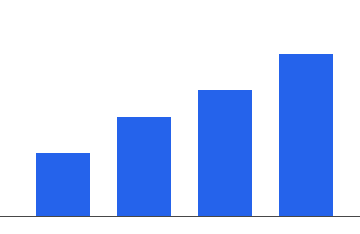
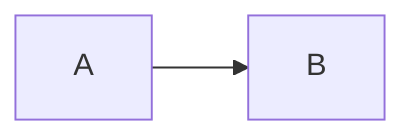

<!-- text id=t1 x=80 y=40 w=900 h=120 size=56 weight=bold -->
# One of every kind

<!-- image id=i1 x=1000 y=40 w=400 h=260 fit=contain -->


<!-- shape id=s1 kind=ellipse x=1460 y=40 w=380 h=260 fill=linear(45,accent1,accent2) -->
Shape text

<!-- shape id=s2 kind=arrow x=80 y=200 w=800 h=0 stroke=accent3 stroke-width=6 -->

<!-- code id=c1 x=80 y=260 w=860 h=300 lines=1 size=24 -->
```python
print("hello")
```

<!-- table id=b1 x=1000 y=340 w=840 h=220 size=24 -->
| Kind | Body |
|------|------|
| text | markdown |

<!-- diagram id=d1 x=80 y=600 w=560 h=300 -->


<!-- math id=m1 x=680 y=600 w=560 h=140 -->
$$E = mc^2$$

<!-- video id=v1 x=1280 y=600 w=560 h=315 src=assets/missing.mp4 poster=assets/hero.png muted -->

<!-- embed id=e1 x=680 y=780 w=560 h=240 src=https://www.youtube.com/watch?v=dQw4w9WgXcQ name="Example video" -->

<!-- group id=g1 items=s1,i1 -->
