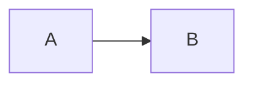

<!-- text id=t1 x=120 y=60 w=800 h=120 -->
# Every element kind

<!-- image id=i1 x=1000 y=60 w=800 h=450 fit=cover -->


<!-- shape id=s1 kind=ellipse x=120 y=220 w=300 h=300 fill=accent2 -->

<!-- code id=c1 x=460 y=220 w=500 h=300 lines=1,3-4 -->
```rust
fn main() {
    println!("hi");
}
```

<!-- table id=b1 x=120 y=560 w=800 h=300 -->
| Region | Q2 | Q3 |
|--------|---:|---:|
| Kuwait | 10 | 12 |

<!-- diagram id=d1 x=1000 y=560 w=400 h=300 -->


<!-- math id=m1 x=1440 y=560 w=360 h=120 -->
$$E = mc^2$$

<!-- video id=v1 x=1440 y=700 w=360 h=200 src=assets/demo.mp4 poster=assets/demo.jpg muted loop -->

<!-- embed id=e1 x=120 y=900 w=400 h=150 src=https://www.youtube-nocookie.com/embed/xyz poster=assets/yt.jpg -->

<!-- group id=g1 items=s1,c1 -->
