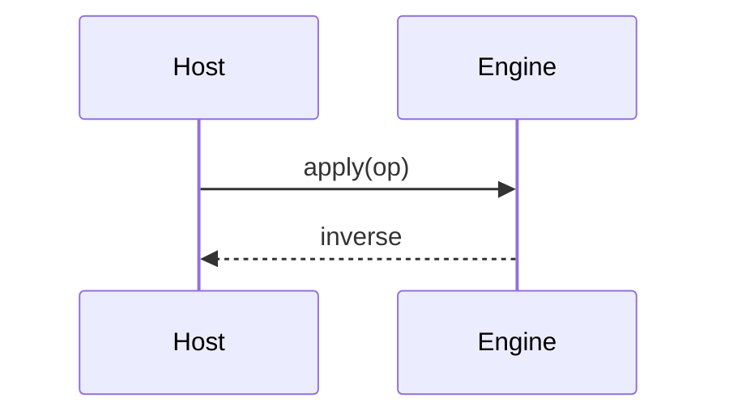

<!-- diagram id=d1 x=100 y=100 w=800 h=600 -->


<!-- math id=m1 x=1000 y=100 w=800 h=200 -->
$$\sum_{i=1}^{n} i = \frac{n(n+1)}{2}$$

<!-- math id=m2 x=1000 y=400 w=800 h=200 -->
```math
e^{i\pi} + 1 = 0
```

<!-- text id=t1 x=1000 y=700 w=800 h=200 -->
Inline math like $a^2 + b^2 = c^2$ stays in text.
